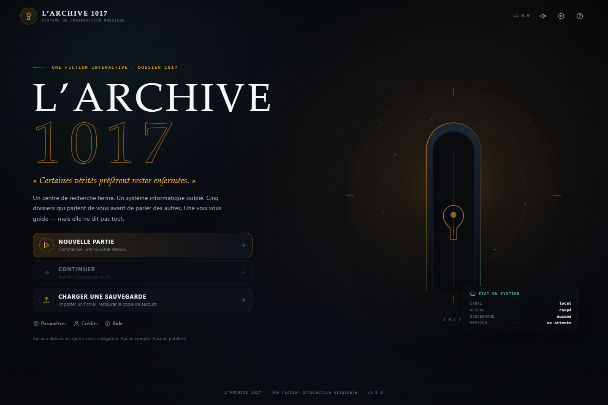
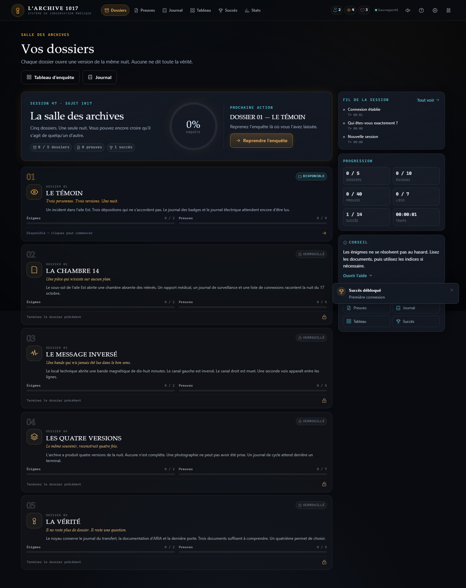
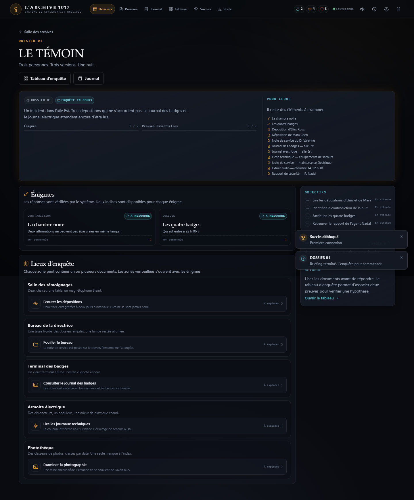
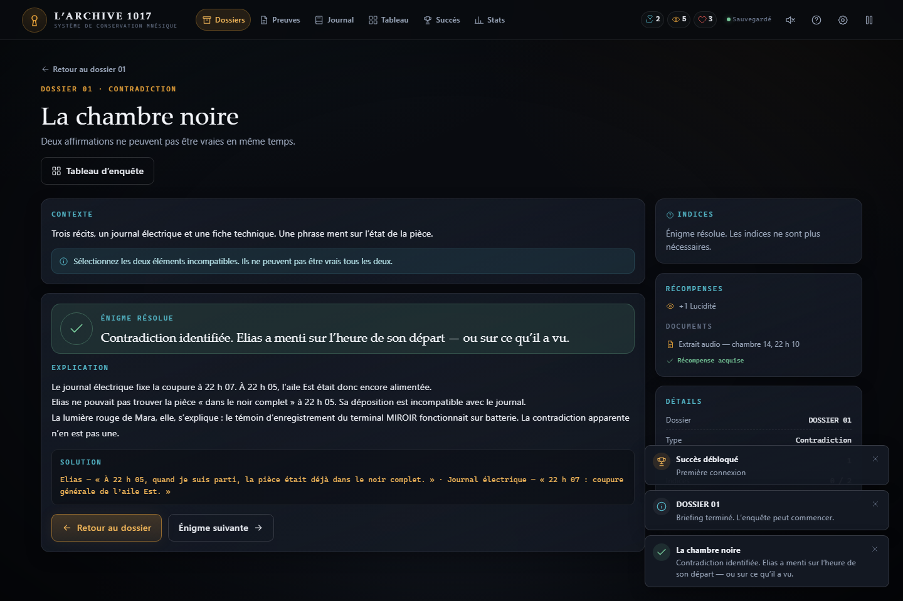
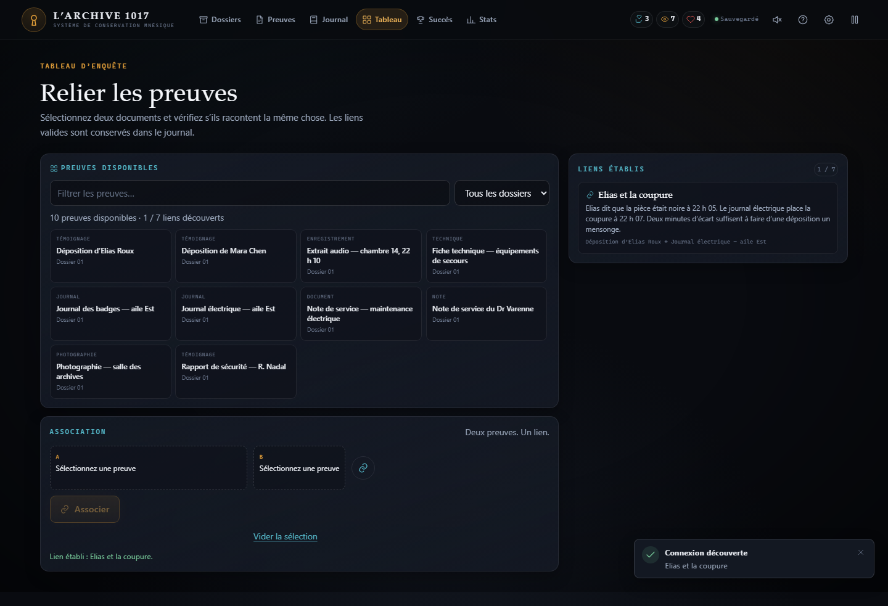
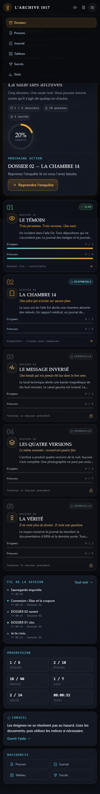

# L’ARCHIVE 1017

> « Certaines vérités préfèrent rester enfermées. »

**L’ARCHIVE 1017** est un thriller psychologique interactif jouable dans le navigateur. Vous ouvrez un ancien système informatique censé contenir les archives d’un centre de recherche fermé. Cinq dossiers, trois témoins, une voix qui prétend vous aider — et une question qui revient : enquêtez-vous sur une expérience passée, ou êtes-vous au centre de cette expérience ?

- **Jouer :** [https://casifox.github.io/l-archive-1017/](https://casifox.github.io/l-archive-1017/)
- **Dépôt :** [https://github.com/Casifox/l-archive-1017](https://github.com/Casifox/l-archive-1017)
- **Version :** 1.0.0
- **Licence :** MIT

---

## Aperçu

| Accueil | Salle des archives |
|---|---|
|  |  |

| Dossier d’enquête | Énigme résolue |
|---|---|
|  |  |

| Tableau d’enquête | Version mobile |
|---|---|
|  |  |

Ces captures sont générées par le test de bout en bout réel (`tests/e2e.mjs`), pas par une maquette.

---

## Le jeu

L’histoire se déroule dans l’**IRMP**, un institut de recherche sur la mémoire et la perception, fermé après un incident survenu le 17 octobre 2017. Le joueur reçoit un accès à **ARCHIVE 1017**, un système de conservation mnésique abandonné.

Chaque dossier apporte une version différente de la même nuit :

1. **Le témoin** — trois dépositions qui ne s’accordent pas.
2. **La chambre 14** — une pièce absente de tous les plans.
3. **Le message inversé** — une bande magnétique qu’il faut décoder.
4. **Les quatre versions** — quatre reconstructions du même souvenir.
5. **La vérité** — la chaîne de preuves et la dernière porte.

Le jeu alterne lecture de documents, comparaison de sources, énigmes de logique, déduction, cryptographie et décisions narratives. Les valeurs de **Confiance**, **Lucidité** et **Empathie** évoluent selon vos choix et influencent certaines fins. Ce sont des mécaniques narratives, pas une mesure de votre personnalité.

### Contenu

| Élément | Quantité |
|---|---:|
| Dossiers narratifs | 5 |
| Énigmes jouables | 10 |
| Documents et preuves | 40 |
| Documents secrets | 3 |
| Connexions du tableau | 7 |
| Succès | 14 |
| Fins | 4, dont 1 secrète |

Les énigmes couvrent la contradiction, la logique, la chronologie, la déduction, la cryptographie, le code et la synthèse finale. Chaque énigme possède deux indices progressifs et une explication après résolution. Une mauvaise réponse ne bloque jamais définitivement.

---

## Fonctionnalités

- Cinq dossiers avec briefing, lieux d’enquête, objectifs, preuves et clôture narrative.
- Dix énigmes réellement vérifiées, avec solutions déclaratives dans `data/puzzles.js`.
- Inventaire filtrable, journal automatique, tableau d’enquête interactif.
- Statistiques narratives et quatorze succès persistants.
- Quatre fins distinctes, dont une fin secrète conditionnée par les preuves, les contradictions et la Lucidité.
- Sauvegarde versionnée avec copie de secours, export/import JSON et réinitialisation confirmée.
- Paramètres de volume, son, animations, taille de texte, vitesse du texte, confort visuel et contraste.
- Ambiance sonore générée localement avec la Web Audio API. Aucun fichier audio externe.
- Interface responsive, navigation clavier, focus visible, messages accessibles.
- Aucun framework, aucune dépendance d’exécution, aucune requête réseau, aucun traceur.

---

## Technologies

- HTML5 sémantique.
- CSS3 (variables, grilles, animations, `prefers-reduced-motion`).
- JavaScript moderne en modules ES natifs.
- Web Audio API pour les sons générés.
- `localStorage` pour la sauvegarde, le profil et les paramètres.
- Aucun backend, aucune base de données, aucun compte, aucune clé API.
- Playwright + Chromium uniquement pour les tests de bout en bout.

Le jeu est prévu pour fonctionner dans un sous-dossier GitHub Pages, avec des chemins relatifs et un routage par hash.

---

## Lancer le jeu en local

Le jeu utilise des modules ES : il doit être servi par HTTP, pas ouvert directement en `file://`.

```bash
# Option 1 — serveur inclus, sans dépendance
npm run serve
# puis ouvrir http://127.0.0.1:4173/
```

```bash
# Option 2 — n’importe quel serveur statique
python -m http.server 4173
```

Le serveur inclus lit les sources par défaut. Pour tester l’artefact de publication :

```bash
npm run build
# Windows PowerShell
$env:SERVE_SITE=1; npm run serve
# macOS / Linux
SERVE_SITE=1 npm run serve
```

---

## Tests

```bash
npm install                 # Playwright, dépendance de développement uniquement
npm test                    # 101 tests unitaires et d’intégrité
npm run build               # construit _site et vérifie références, imports et réseau
npx playwright install chromium
npm run test:e2e            # 62 vérifications réelles dans Chromium
npm run qa                  # tests + build + E2E
```

Résultats de la version 1.0.0 :

| Suite | Résultat |
|---|---|
| Tests unitaires et d’intégrité (`node:test`) | **101 / 101** |
| Build et vérification des références | **succès**, 58 fichiers, 161 imports |
| Test de bout en bout Chromium | **62 / 62** |
| Erreurs console | **0** |
| Requêtes réseau externes | **0** |
| Captures générées | **18** |

Le détail des vérifications, des limites et des bugs corrigés se trouve dans [`QA.md`](./QA.md).

---

## Structure du projet

```text
l-archive-1017/
├── index.html
├── 404.html
├── README.md
├── QA.md
├── CHANGELOG.md
├── CONTRIBUTING.md
├── LICENSE
├── package.json
├── .nojekyll
├── .github/
│   └── workflows/
│       └── deploy.yml
├── assets/
│   └── icons/
├── css/
│   ├── variables.css
│   ├── base.css
│   ├── layout.css
│   ├── components.css
│   ├── screens.css
│   ├── animations.css
│   └── responsive.css
├── data/
│   ├── story.js
│   ├── dossiers.js
│   ├── puzzles.js
│   ├── evidence.js
│   ├── connections.js
│   ├── achievements.js
│   └── endings.js
├── js/
│   ├── main.js
│   ├── router.js
│   ├── state.js
│   ├── save-schema.js
│   ├── save-manager.js
│   ├── profile-manager.js
│   ├── settings.js
│   ├── audio.js
│   ├── dialogue.js
│   ├── puzzles.js
│   ├── achievements.js
│   ├── endings.js
│   ├── dom.js
│   ├── utils.js
│   ├── version.js
│   └── ui/
│       ├── menu.js, intro.js, hub.js, dossier.js, puzzle.js
│       ├── inventory.js, journal.js, board.js, stats.js
│       ├── achievements.js, settings.js, load.js, help.js
│       ├── credits.js, finale.js, ending.js, not-found.js
│       ├── shell.js, modal.js, toast.js, boot.js
│       ├── evidence.js, page.js, icons.js, art.js
├── scripts/
│   ├── serve.mjs
│   └── build.mjs
├── tests/
│   ├── data-integrity.test.js
│   ├── puzzles.test.js
│   ├── save-manager.test.js
│   ├── progression.test.js
│   ├── endings.test.js
│   ├── achievements.test.js
│   ├── helpers.js
│   └── e2e.mjs
└── docs/
    └── screenshots/
```

---

## Sauvegarde

Le jeu sauvegarde automatiquement après chaque action importante.

| Clé `localStorage` | Rôle |
|---|---|
| `archive1017.save.v1` | Sauvegarde principale versionnée |
| `archive1017.save.backup.v1` | Copie de secours de l’état valide précédent |
| `archive1017.save.corrupt.v1` | Données illisibles conservées pour diagnostic |
| `archive1017.profile.v1` | Succès et fins découvertes, conservés entre les parties |
| `archive1017.settings.v1` | Paramètres d’affichage et de son |

- Une sauvegarde d’une version future est refusée et **jamais écrasée**.
- Une sauvegarde ancienne est migrée.
- Un import est validé avant tout remplacement ; une donnée invalide est refusée sans toucher à la sauvegarde actuelle.
- L’export produit un fichier JSON lisible.
- La réinitialisation demande le mot `EFFACER`.
- Les clés dangereuses (`__proto__`, `constructor`, `prototype`) sont ignorées à l’import.

---

## Publication GitHub Pages

Le dépôt contient un workflow officiel `.github/workflows/deploy.yml` :

1. `actions/checkout@v4`
2. `actions/setup-node@v4` (Node 22)
3. `npm ci`
4. `npm test`
5. `npm run build`
6. `actions/configure-pages@v5`
7. `actions/upload-pages-artifact@v3` avec `_site`
8. `actions/deploy-pages@v5`

Pour activer la publication sur un nouveau dépôt :

1. **Settings → Pages → Build and deployment → Source : GitHub Actions**.
2. Pousser sur `main`.
3. Attendre la fin du workflow, puis vérifier l’URL.

Le site est prévu pour :

- `https://<utilisateur>.github.io/<dépôt>/`

Le routage par hash (`#/hub`, `#/dossier/1`, etc.) évite les erreurs 404 lors d’un rafraîchissement. Une page `404.html` autonome est également fournie.

---

## Confidentialité

- Aucune donnée personnelle collectée.
- Aucun compte, aucune publicité, aucun traceur, aucune télémétrie.
- Aucun appel réseau dans le code livré (vérifié par le script de build).
- Aucune intelligence artificielle externe, aucune clé API.
- La sauvegarde reste dans le navigateur, sauf export manuel de votre part.
- Après chargement, le jeu ne nécessite aucune connexion Internet.

---

## Accessibilité

- Taille de texte réglable (4 niveaux).
- Vitesse de texte réglable, jusqu’à l’affichage instantané.
- Réduction des animations, y compris le respect de `prefers-reduced-motion`.
- Mode confort visuel et contraste élevé.
- Navigation complète au clavier, focus visible, piège de focus dans les modales.
- Informations jamais transmises uniquement par la couleur : chaque statut a un texte et une icône.
- Textes alternatifs sur les illustrations et libellés ARIA sur les commandes.

Limites : aucun test avec un lecteur d’écran physique, ni sur iPhone/Android réel n’a été effectué dans cette version. Voir [`QA.md`](./QA.md).

---

## Limites connues

- Tests de bout en bout exécutés uniquement dans Chromium (règle du projet), pas dans Firefox ou WebKit.
- Aucune mesure réelle de FPS ou de mémoire sur appareil physique.
- Aucun test avec lecteur d’écran (NVDA, VoiceOver, TalkBack) ni sur appareil iOS/Android réel.
- Le son est synthétisé : il n’y a pas de bande originale enregistrée.
- Pas de service worker : le jeu fonctionne hors ligne après chargement, mais le premier chargement nécessite le serveur.
- Les captures des fins proviennent d’une sauvegarde de test complète générée par le harnais E2E, pas d’une partie de 60 minutes.
- Toutes les énigmes ont une solution déterministe et vérifiée, mais une compréhension fine de certains textes peut demander plusieurs lectures.

---

## Crédits

**L’ARCHIVE 1017** est une fiction interactive originale. Conception, écriture, développement, direction artistique et tests réalisés avec OpenCode.

Le jeu, ses personnages, ses documents et son univers sont fictifs. Toute ressemblance avec des personnes ou des institutions réelles serait fortuite.

Aucune équipe fictive n’est créditée : les rôles listés dans l’interface décrivent le travail réel effectué sur le projet.

---

## Licence

MIT — voir [`LICENSE`](./LICENSE).
